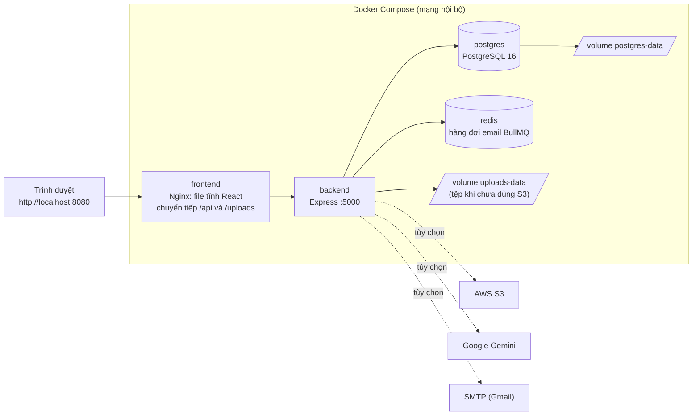

# Triển khai bằng Docker Compose — EduVerse

> Chạy toàn bộ hệ thống (giao diện + API + CSDL) trên một máy bằng **một lệnh**, theo [ADR-006](design-decisions.md#adr-006).  
> **Cập nhật:** 27/10/2026 — thêm Redis (hàng đợi gửi email BullMQ) và hướng dẫn gửi email thật bằng Gmail. Bản đầu tiên: 22/10/2026 (Frontend + Backend + PostgreSQL).

---

## 1. Kiến trúc khi chạy bằng Docker



| Service | Image / build | Vai trò | Mở ra máy chủ |
|---|---|---|---|
| `frontend` | build từ `frontend/Dockerfile` (Node build → `nginx:1.27`) | Phục vụ giao diện, chuyển tiếp `/api` và `/uploads` tới backend nên trình duyệt chỉ làm việc với **một địa chỉ** | `FRONTEND_PORT` (mặc định `8080`) |
| `backend` | build từ `backend/Dockerfile` (`node:22-slim`) | API Express. Lần đầu tự tạo bảng + nạp dữ liệu mẫu | Không (chỉ trong mạng nội bộ) |
| `postgres` | `postgres:16-alpine` | CSDL riêng của stack Docker | Không |
| `redis` | `redis:7-alpine` (bật `appendonly`, volume `redis-data`) | Hàng đợi BullMQ cho email tự động (OTP, đặt lại mật khẩu). Email đang chờ gửi không mất khi khởi động lại | Không |

Redis hiện **chỉ dùng cho hàng đợi email**. Rate limiter và job nén ZIP vẫn chạy trong bộ nhớ của backend. Backend không cần Redis để chạy: thiếu Redis thì email được gửi trực tiếp (xem mục 4.1).

---

## 2. Yêu cầu

- Docker Desktop (Windows/Mac) hoặc Docker Engine + Compose v2 (Linux). Kiểm tra: `docker compose version`.
- Docker Desktop **đang chạy** trước khi gõ lệnh.
- Cổng `8080` còn trống (hoặc đổi `FRONTEND_PORT`).

---

## 3. Chạy lần đầu

Chạy ở thư mục gốc của repo (PowerShell):

```powershell
# 1. Tạo file cấu hình từ mẫu rồi sửa giá trị (đặc biệt là mật khẩu và 2 khóa JWT)
Copy-Item .env.example .env
notepad .env

# 2. Build và chạy nền
docker compose up -d --build

# 3. Xem tiến độ khởi tạo CSDL (Ctrl+C để thoát, container vẫn chạy)
docker compose logs -f backend
```

Lần đầu mất vài phút: tải image, build, rồi backend tạo 20 bảng và nạp dữ liệu mẫu (khoảng 1 phút). Khi `docker compose ps` báo `backend` là `healthy` thì mở **http://localhost:8080**.

Tạo chuỗi ngẫu nhiên cho `JWT_SECRET` / `REFRESH_TOKEN_SECRET` (chạy 2 lần, mỗi khóa một giá trị khác nhau):

```powershell
-join ((48..57) + (97..122) | Get-Random -Count 48 | ForEach-Object { [char]$_ })
```

**Tài khoản mẫu** (mật khẩu `EduVerse@2026`): `admin@eduverse.com`, `manager@eduverse.com`, `teacher.an@eduverse.com`, `teacher.binh@eduverse.com`, `student.dung@eduverse.com`.

---

## 4. Biến môi trường (`.env` ở thư mục gốc)

| Biến | Bắt buộc | Mặc định | Ý nghĩa |
|---|---|---|---|
| `POSTGRES_PASSWORD` | ✅ | — | Mật khẩu PostgreSQL. Chỉ dùng chữ và số vì được ghép vào chuỗi kết nối |
| `POSTGRES_USER`, `POSTGRES_DB` | | `eduverse` | Tên user và CSDL |
| `JWT_SECRET`, `REFRESH_TOKEN_SECRET` | ✅ | — | Hai khóa ký token, **phải khác nhau**, mỗi khóa dài từ 32 ký tự |
| `FRONTEND_PORT` | | `8080` | Cổng truy cập trên máy bạn |
| `NODE_ENV` | | `development` | `production` đặt cookie đăng nhập ở chế độ chỉ-HTTPS nên chỉ dùng khi có HTTPS |
| `DB_AUTO_INIT` | | `true` | `false` = không tự tạo bảng/nạp dữ liệu mẫu |
| `GEMINI_API_KEY`, `GEMINI_MODEL` | | trống | AI sinh câu hỏi. Trống thì API `/ai/*` trả 503 |
| `AWS_REGION`, `S3_BUCKET`, `AWS_ACCESS_KEY_ID`, `AWS_SECRET_ACCESS_KEY` | | trống | Để trống `AWS_REGION` hoặc `S3_BUCKET` thì tệp lưu trong volume `uploads-data` |
| `SMTP_HOST`, `SMTP_PORT`, `SMTP_SECURE`, `SMTP_USER`, `SMTP_PASS`, `MAIL_FROM` | | trống | Gửi email thật. Để trống `SMTP_HOST` thì OTP và link đặt lại mật khẩu được in ra log backend. Xem mục 4.1 |

File `.env` **không được commit** (đã nằm trong `.gitignore`). Biến `CLIENT_URL`, `BACKEND_URL`, `DATABASE_URL`... do `docker-compose.yml` tự đặt, không cần khai báo.

> Biến đã đặt sẵn trong terminal (ví dụ `AWS_ACCESS_KEY_ID` do AWS CLI) sẽ **ghi đè** giá trị cùng tên trong `.env`.

### 4.1. Gửi email thật (OTP kích hoạt, đặt lại mật khẩu)

Mặc định (không điền `SMTP_*`), email **không được gửi đi** mà in ra log backend (`docker compose logs backend`, tìm dòng `[EMAIL → LOG]`) để dev lấy mã OTP. Muốn gửi thật bằng Gmail:

1. Tài khoản Google bật **Xác minh 2 bước**, rồi tạo **Mật khẩu ứng dụng** (App Password) tại <https://myaccount.google.com/apppasswords>. Google cho một chuỗi 16 ký tự (hiển thị thành 4 nhóm, dán kèm khoảng trắng cũng được).
2. Điền vào file `.env` **trên máy bạn** (file này không được commit), các dòng:
   - `SMTP_HOST=smtp.gmail.com`
   - `SMTP_USER=ten-ban@gmail.com`
   - `SMTP_PASS=mat-khau-ung-dung-16-ky-tu`
   - `MAIL_FROM=EduVerse <ten-ban@gmail.com>`
   - Cổng mặc định 465 (TLS). Muốn dùng cổng 587 thì thêm `SMTP_PORT=587` (STARTTLS).
3. Khởi động lại backend: `docker compose up -d --build`.
4. Thử: đăng ký tài khoản mới bằng email thật, mã OTP sẽ về hộp thư (gmail giới hạn khoảng 500 thư/ngày, đủ cho đồ án). Nếu không thấy thì xem mục 8.

> **Bảo mật:** mật khẩu ứng dụng cho phép gửi thư thay tài khoản của bạn. Không commit, không dán vào chat/issue. Nếu lộ, thu hồi ở trang Mật khẩu ứng dụng rồi tạo cái mới.

Chế độ hoạt động (tự chọn theo biến môi trường, thiếu gì vẫn chạy):

| Có `REDIS_URL` | Có `SMTP_HOST` | Cách chạy |
|---|---|---|
| ✅ (Docker đã đặt sẵn) | ✅ | Email vào hàng đợi BullMQ `email`, worker gửi qua SMTP; lỗi thì thử lại tối đa 5 lần (chờ 5s, 10s, 20s...) |
| ✅ | | Hàng đợi BullMQ, worker in email ra log |
| | ✅ | Gửi SMTP ngay trong nền, không qua hàng đợi |
| | | In email ra log (như trước đây) |

- Gửi email **không bao giờ làm hỏng API**: đăng ký, gửi lại OTP, quên mật khẩu vẫn trả thành công dù Redis hoặc SMTP lỗi (lỗi chỉ ghi cảnh báo trong log). Redis không phản hồi sau 3 giây thì tự chuyển sang gửi trực tiếp.
- Trang Tổng quan của Admin hiện trạng thái "Gửi email": `Đã cấu hình` khi có `SMTP_HOST`, ngược lại `Chế độ dev`. Trạng thái chỉ phản ánh có cấu hình, không kiểm tra đăng nhập SMTP.
- Job trong hàng đợi chứa mã OTP/link nên bị xóa ngay khi gửi xong; job lỗi giữ 1 giờ để tra cứu.
- Chạy `npm run dev` (không Docker): cần cài thư viện (`cd backend; npm install`) và tự đặt `SMTP_*` (và `REDIS_URL=redis://localhost:6379` nếu có Redis) trong `backend/.env`. Không đặt thì email in ra console như cũ.

---

## 5. Khởi tạo CSDL tự động

Khi backend khởi động (`backend/src/scripts/dockerStart.js`):

1. Chờ PostgreSQL sẵn sàng (thử lại tối đa 60 giây).
2. Nếu CSDL **trống**: chạy lần lượt `migrateAndSeed.js` (tạo bảng + tài khoản, lớp, đề mẫu) → mọi file trong `scripts/migrations/` (theo thứ tự ngày) → `seedEduVerseCourses.js` (khóa học mẫu). Xong thì ghi dấu vào bảng `docker_init_state`.
3. Lần khởi động sau thấy dấu "đã xong" thì bỏ qua. Nếu lần khởi tạo trước bị lỗi dở dang thì tự chạy lại (các script đều idempotent).
4. CSDL đã có sẵn bảng `users` không do bước này tạo (ví dụ trỏ nhầm tới Neon dùng chung) thì **không bị đụng vào**.

**Khi có migration mới** (sau khi `git pull` code của nhóm), CSDL Docker đã có dữ liệu nên không tự chạy lại. Build lại rồi chạy tay, ví dụ:

```powershell
docker compose up -d --build
docker compose exec backend node src/scripts/migrations/20261017-notifications.js
```

---

## 6. Lưu trữ tệp tải lên

- **Chưa cấu hình S3** (mặc định): tệp lưu trong volume `uploads-data`, giữ nguyên khi `docker compose down`. Link tải/xem đi qua Nginx nên dùng được ngay.
- **Đã điền thông tin S3** trong `.env`: dùng S3 như mô tả ở [api-uploads.md](../api/api-uploads.md); bucket cần CORS cho PUT/GET từ `http://localhost:8080`.

---

## 7. Lệnh thường dùng

| Việc cần làm | Lệnh |
|---|---|
| Xem trạng thái | `docker compose ps` |
| Xem log | `docker compose logs -f backend` |
| Dừng (giữ dữ liệu) | `docker compose down` |
| Chạy lại | `docker compose up -d` |
| Build lại sau khi sửa code | `docker compose up -d --build` |
| **Xóa sạch dữ liệu** để khởi tạo lại từ đầu | `docker compose down -v` |
| Mở psql vào CSDL | `docker compose exec postgres psql -U eduverse -d eduverse` |

---

## 8. Sự cố thường gặp

| Hiện tượng | Cách xử lý |
|---|---|
| `required variable ... is missing a value` | Chưa tạo `.env`: `Copy-Item .env.example .env` |
| `port is already allocated` | Cổng 8080 đang bị chiếm: đặt `FRONTEND_PORT=8081` trong `.env` rồi `docker compose up -d` |
| `backend` mãi không `healthy` | `docker compose logs backend` xem lỗi. Lần đầu có thể mất vài phút |
| Container báo `exec format error` hoặc `unable to find user node` | Image tải về bị hỏng trên máy: `docker compose down --rmi local`, `docker rmi -f <image lỗi>`, `docker pull <image lỗi>` rồi `docker compose build --no-cache`. Dự án dùng image Debian (`node:22-slim`, `nginx:1.27`) vì image `node:20-alpine` từng bị lỗi này trên một máy của nhóm |
| Đăng nhập được nhưng bị đăng xuất sau ~15 phút | Đang để `NODE_ENV=production` mà truy cập bằng HTTP. Đổi lại `development` hoặc dùng HTTPS |
| Không nhận được email OTP | `docker compose logs backend`: có dòng `[EMAIL → LOG]` nghĩa là chưa điền `SMTP_HOST` (mã OTP nằm ngay trong log). Có `⚠️ Gửi email ... thất bại: Invalid login` hoặc `535` nghĩa là sai `SMTP_USER`/mật khẩu ứng dụng (phải là App Password, không phải mật khẩu Gmail). Kiểm tra cả thư mục Spam |
| Log lặp lại `Hàng đợi email (Redis) lỗi` | Backend không nối được Redis: `docker compose ps redis`, `docker compose logs redis`. Trong lúc đó email vẫn được gửi trực tiếp |
| Tải tệp báo lỗi 413 | Vượt giới hạn: tài liệu 50MB, bài nộp 100MB (Nginx cho phép tối đa 120MB) |
| Muốn dùng lại dữ liệu cũ sau khi `down -v` | Không khôi phục được; `down -v` xóa cả volume CSDL |

---

## 9. Khác biệt với chạy phát triển (`npm run dev`)

| | Phát triển hằng ngày | Docker Compose |
|---|---|---|
| Chạy bằng | `npm run dev` ở `backend/` và `frontend/` | `docker compose up -d --build` |
| Địa chỉ | `localhost:5173` | `localhost:8080` |
| CSDL | **Neon dùng chung** của nhóm (`backend/.env`) | PostgreSQL **riêng** trong Docker, dữ liệu không đồng bộ với Neon |
| Cấu hình | `backend/.env` | `.env` ở thư mục gốc |

Dùng Docker khi demo, chấm bài hoặc thử trên máy sạch; dùng `npm run dev` khi đang viết code.

---

## 10. Chưa có

- Hàng đợi BullMQ cho việc khác (nén ZIP cả lớp, nhập người dùng hàng loạt): hiện chỉ email dùng hàng đợi.
- HTTPS, tên miền, triển khai lên cloud, CI/CD.
- Sao lưu CSDL tự động (có thể `docker compose exec postgres pg_dump ...` thủ công).
