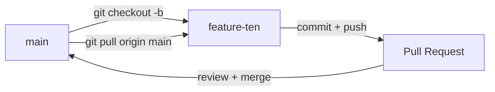

# Quy Trình Git — EduVerse

> **Repo:** `https://github.com/dunghvd79/eduverse`  
> **Áp dụng cho:** mọi thành viên, mọi thay đổi code và tài liệu (Docs-as-Code).  
> **Cập nhật lần cuối:** 12/10/2026

---

## 1. Mô hình nhánh

| Nhánh | Mục đích | Quy tắc |
|---|---|---|
| `main` | Code ổn định, đã review | **Chỉ cập nhật qua Pull Request.** Không commit/push trực tiếp, không `push --force` |
| `feature-<tên>` | Nhánh làm việc của từng thành viên: `feature-dung`, `feature-ngocson`, `feature-anh`, `feature-manh` | Tạo từ `main`, thường xuyên cập nhật từ `main` |
| `feature-<tên>-<việc>` *(tùy chọn)* | Việc lớn, tách riêng cho dễ review. VD: `feature-manh-assignments` | Tạo từ `main` **mới nhất**, xóa sau khi merge |



---

## 2. Quy trình làm việc hằng ngày

```bash
# 1. Đầu buổi: đứng ở nhánh của mình và lấy code mới nhất của main
git checkout feature-<tên>
git pull origin main          # gộp main vào nhánh mình, xử lý conflict ngay nếu có

# 2. Sau khi pull: cài lại thư viện & chạy migration nếu có thay đổi (xem mục 5)

# 3. Làm việc, commit nhỏ và thường xuyên
git add <file cụ thể>         # tránh "git add ." để không lọt file rác / .env
git commit -m "feat(quizzes): add attempt review page"

# 4. Đẩy lên GitHub
git push origin feature-<tên>

# 5. Xong một phần trọn vẹn -> tạo Pull Request vào main
```

> ⚠️ **Làm việc trong đúng thư mục repo.** Không copy cả repo vào một thư mục con rồi commit (sự cố 09/10/2026: code Sprint 3 bị commit nhầm trong thư mục `eduverse-feature-dung/`, phải ghép tay sang nhánh khác).

---

## 3. Quy ước commit message

Theo chuẩn **Conventional Commits**, viết **tiếng Anh**, ngắn gọn:

```
<type>(<scope>): <mô tả ngắn ở thì hiện tại>

<thân - tùy chọn: liệt kê thay đổi chính, lý do>
```

| `type` | Khi nào dùng |
|---|---|
| `feat` | Thêm tính năng mới |
| `fix` | Sửa lỗi |
| `refactor` | Sửa cấu trúc code, không đổi hành vi |
| `docs` | Chỉ sửa tài liệu trong `docs/`, README... |
| `test` | Thêm / sửa test |
| `chore` | Cấu hình, thư viện, script |

**`scope`** là module: `auth`, `users`, `courses`, `classes`, `quizzes`, `uploads`, `assignments`, `docs`...

Ví dụ thật trong repo:
```
feat(classes): Sprint 4 classes & enrollments API and class pages for all roles
fix(auth): preserve refresh cookie on rotation race and rate-limit users/me/password
refactor(validation): shared body/query/params middleware, validate :id and GET /users query
```

**Ghi công đồng tác giả:** khi đưa code của người khác vào commit của mình, thêm dòng cuối:
```
Co-authored-by: tuanmanh205 <tuanmanhdang12012005@gmail.com>
```

**Tác giả commit phải là chính mình:** cấu hình `git config user.name` / `user.email` đúng tài khoản GitHub. Không để công cụ AI (Copilot...) đứng tên tác giả, nếu không GitHub sẽ không tính đóng góp cho bạn.

---

## 4. Không bao giờ commit

| Không commit | Lý do / thay bằng |
|---|---|
| `backend/.env`, mọi file `.env` | Chứa mật khẩu DB, JWT secret, **API key Gemini / AWS**. Đã có trong `.gitignore`. Thêm biến mới → cập nhật `backend/.env.example` (giá trị mẫu) |
| `node_modules/`, `dist/` | Sinh ra từ `npm install` / `npm run build` |
| API key, mật khẩu trong code hoặc tài liệu | Đọc từ `process.env` (qua `backend/src/config/env.js`) |
| File test tạm, ảnh chụp màn hình debug | Để ngoài repo |

> Lỡ commit secret: **đổi secret ngay** (tạo key mới, xóa key cũ) — xóa khỏi commit sau không đủ vì lịch sử Git vẫn còn.  
> Không dán API key vào nhóm chat; mỗi người tự tạo key Gemini riêng (aistudio.google.com/apikey).

---

## 5. Thay đổi CSDL (Migration)

- **Không dùng `sequelize.sync({ alter: true })` trên DB dùng chung** (Neon dev) — từng tạo trùng lặp nhiều ràng buộc UNIQUE.
- Thêm bảng / cột / index → viết script **idempotent** (chạy lại nhiều lần không lỗi) trong `backend/src/scripts/migrations/YYYYMMDD-<tên>.js`, dùng hàm chung trong `helpers.js`, thêm lệnh `db:migrate:<tên>` vào `backend/package.json`, cập nhật `docs/database/schema.md`.
- Ghi rõ trong mô tả PR: *"Cần chạy `npm run db:migrate:<tên>`"* và đã chạy trên Neon dev hay chưa.

**Sau khi pull code mới** (trong `backend/`):
```bash
npm install                      # nếu package.json thay đổi
npm run db:migrate:categories    # các migration hiện có — chỉ cần nếu dùng DB riêng
npm run db:migrate:classes
npm run db:migrate:quizzes
npm run db:migrate:assignments
```
(trong `frontend/`: `npm install` nếu `package.json` thay đổi)

---

## 6. Pull Request

**Tiêu đề:** giống commit message (`feat(quizzes): ...`).

**Mô tả PR cần có:**
1. Làm gì, theo đặc tả nào (`docs/api/...`), khác đặc tả chỗ nào và lý do.
2. Cách kiểm thử và kết quả (test API, test giao diện, ảnh chụp màn hình).
3. Migration / biến môi trường mới cần thêm.

**Checklist trước khi tạo PR:**
- [ ] `git pull origin main` và đã xử lý hết conflict
- [ ] Frontend build không lỗi: `cd frontend && npm run build`
- [ ] Backend khởi động được, các API đã sửa chạy đúng
- [ ] Không có `.env` / API key trong thay đổi (`git diff --cached`)
- [ ] Cập nhật tài liệu liên quan: đặc tả API, `schema.md`, `docs/project/state.md`

**Review & merge:**
- Ít nhất **1 thành viên khác** xem PR trước khi merge.
- PR lớn (nhiều sprint) → review theo từng commit.
- Sau khi merge, mọi người `git pull origin main` vào nhánh của mình.

---

## 7. Xử lý conflict

1. `git pull origin main` → Git báo file conflict.
2. Mở file, tìm các đoạn `<<<<<<<` / `=======` / `>>>>>>>`, giữ lại phần đúng (thường là gộp cả hai).
3. Chạy lại build/test, rồi `git add <file>` → `git commit`.
4. Không chắc phần nào đúng → hỏi người viết đoạn code đó, **không xóa bừa code của người khác**.

> Hai người cùng làm một module dễ conflict lớn (VD: Sprint 3 từng có 2 bản Courses viết song song, conflict 22 file). **Chia việc theo module** và báo nhóm trước khi động vào module người khác đang làm.
