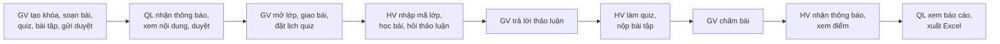

# Kiểm Thử Luồng Chính Qua Giao Diện (E2E)

> Script: [`e2e_luong_chinh.py`](e2e_luong_chinh.py) (Python Playwright). Lần chạy gần nhất: 30/10/2026, **10/10 bước đạt** trên CSDL Neon dùng chung.

## 1. Luồng được kiểm thử

Ba "người dùng" chạy song song trong ba cửa sổ trình duyệt riêng: Giảng viên (tài khoản thử), Quản lý đào tạo (`manager@eduverse.com`), Học viên (tài khoản thử).



| # | Bước | Điều kiện đạt |
|---|---|---|
| 1 | GV tạo khóa (ảnh bìa, danh mục), 1 chương 4 bài, đề quiz 4 câu, đề bài tập, gửi duyệt | Trạng thái khóa `pending` |
| 2 | QL mở chuông thông báo, xem nội dung bài lý thuyết, bấm "Duyệt & xuất bản" | Chuông QL có thông báo; khóa `published`; chuông GV có "đã được duyệt" |
| 3 | GV mở lớp, giao bài tập (hạn +3 ngày), đặt lịch quiz (đóng +5 ngày) | Lớp có mã tham gia; bài tập hiện nút "Chấm bài" |
| 4 | HV nhập mã lớp, mở Khóa học của tôi, bấm "Bắt đầu học" | Thẻ lớp hiện "2 việc sắp đến hạn"; mở đúng bài 1 |
| 5 | HV đánh dấu hoàn thành bài 1, đặt câu hỏi thảo luận, sang bài video, hoàn thành | Câu hỏi hiện trong danh sách |
| 6 | GV nhận thông báo, trả lời, đánh dấu "Đã giải đáp" | Chuông HV có thông báo trả lời |
| 7 | HV bấm "Tiếp tục" (mở bài quiz), làm quiz đúng 3/4 câu, nộp bài tập PDF | Kết quả 7,5 – 3/4; thẻ lớp 4/4 bài, hết việc cần làm |
| 8 | GV chấm bài tập 8 điểm kèm nhận xét | Lưu điểm thành công |
| 9 | HV mở chuông và trang Điểm số | Có thông báo "đã chấm"; tổng kết **8 – Giỏi** (giao diện và API) |
| 10 | QL mở Báo cáo, tab Bảng điểm của lớp, xuất Excel | Lớp có trong báo cáo; file `.xlsx` có 4 sheet, dòng học viên 8 – Giỏi |

## 2. Nội dung khóa học mẫu và điểm mong đợi

Khóa **"Nhập môn Git và GitHub cho người mới bắt đầu"**, chương "Làm quen với Git":

| Bài | Loại | Ghi chú |
|---|---|---|
| Git là gì và vì sao cần quản lý phiên bản | Lý thuyết | ~250 chữ |
| Cài đặt và cấu hình Git | Video | Link YouTube |
| Kiểm tra nhanh: các lệnh Git cơ bản | Quiz | 4 câu (2 một đáp án, 1 nhiều đáp án, 1 đúng/sai), 10 phút, 2 lượt, đạt 5 |
| Thực hành: tạo repository đầu tiên | Bài tập | PDF/ZIP, tối đa 10MB |

Học viên trả lời sai câu nhiều đáp án (chỉ chọn 1 trong 2 đáp án đúng). Theo `docs/requirements/grading-policy.md`:

```
Quiz     = 3/4 × 10 = 7,5
Bài tập  = 8
Tiến độ  = 4/4 bài  = 10
Tổng kết = 0,4 × 7,5 + 0,5 × 8 + 0,1 × 10 = 8,0  → Giỏi (≥ 8)
```

## 3. Cách chạy

1. Bật backend (`cd backend && npm run dev`) và frontend (`cd frontend && npm run dev`).
2. Từ thư mục gốc repo: `python docs/testing/e2e_luong_chinh.py` (thêm `--keep` để giữ dữ liệu thử xem bằng tay).
3. Kết quả: in ra màn hình từng bước `ĐẠT` hoặc vấn đề kèm mức độ (`chặn` / `dữ liệu` / `giao diện`); ảnh chụp và `ket-qua.json` trong `docs/testing/e2e-ket-qua/` (không commit).

> ⚠️ Script chạy thẳng vào CSDL đang cấu hình trong `backend/.env`. Tài khoản thử dạng `sec-test-*@example.com`, chạy xong tự xóa hẳn (kể cả thông báo gửi tới tài khoản thật và tệp tải lên). Còn sót do dừng giữa chừng thì chạy `cd backend && node src/scripts/secTestCleanup.js`.

Nên chạy lại trước mỗi buổi demo và sau khi merge nhánh lớn.
